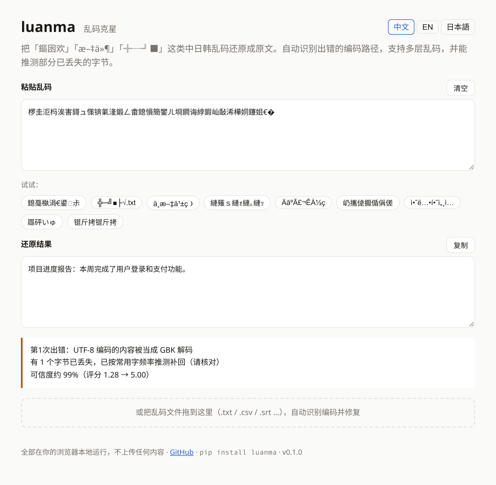

# luanma · 乱码克星

**Fix Chinese / Japanese / Korean mojibake automatically** — 乱码 · 文字化け · 깨진 글자.

[English](README.md) · [简体中文](README.zh-CN.md) · [日本語](README.ja.md)

```
$ luanma "浣犲ソ涓栫晫"
你好世界
$ luanma explain "╬─╝■├√.txt"
文件名.txt
  Error 1: GBK bytes were decoded as CP437(DOS)
  Confidence ~98% (score -0.70 -> 2.50)
```



**Try it in your browser → https://3566264817a-cyber.github.io/luanma/** (single HTML file, works offline, nothing is uploaded)

## Why

[ftfy](https://github.com/rspeer/python-ftfy) is the go-to tool for mojibake, but it [explicitly does not handle](https://ftfy.readthedocs.io/en/latest/avoid.html) the legacy CJK encodings — GBK / GB18030, Big5, Shift-JIS, EUC-KR — which is where most CJK mojibake actually comes from: a UTF-8 CSV opened in Excel on Chinese Windows, a zip file made on Japanese Windows, a `latin1` MySQL column, a Korean game on a Chinese system…

luanma fills that gap. Zero dependencies, pure Python, plus a JavaScript port for the browser.

## What it fixes

| You see | Should be | What happened |
|---|---|---|
| `浣犲ソ涓栫晫` | 你好世界 | UTF-8 opened as GBK (Notepad / Excel on Chinese Windows) |
| `我是一åªçŒ«` | 我是一只猫 | UTF-8 read as Windows-1252 / Latin-1 (web pages, e-mail, databases) |
| `ÄãºÃ£¬ÊÀ½ç` | 你好，世界 | GBK stored in a `latin1` MySQL column |
| `╬─╝■├√.txt` | 文件名.txt | zip made on Chinese Windows, opened on macOS / Linux |
| `縺薙ｓ縺ｫ縺｡縺ｯ` | こんにちは | UTF-8 read as Shift-JIS |
| `屷攜偼擫偱偁傞` | 吾輩は猫である | Shift-JIS game / software on a Chinese system |
| `羉砰いゅ` | 繁體中文 | Big5 read as GBK |
| `안녕하세요` | 안녕하세요 | UTF-8 Korean read as Windows-1252 |
| `救崇窍技夸` | 안녕하세요 | EUC-KR Korean read as GBK |
| `娑旇京鐖滈梻顕€顣�` | 乱码问题 | UTF-8 → GBK mojibake **twice** |
| `锟斤拷` | – | explains that the bytes were destroyed (GBK read as UTF-8 and saved) |

Text that already looks fine is never touched, and mixed strings (correct text with garbled fragments) are fixed piece by piece.

## Install & use

```bash
pip install luanma          # Python ≥ 3.9, no dependencies
```

```python
import luanma

luanma.fix_text("我是一åªçŒ«")        # '我是一只猫'

r = luanma.fix("鏂囦欢鍚嶏細")
r.fixed, r.changed                      # ('文件名：', True)
print(r.explain("en"))                   # which encodings were mixed up, lost bytes, confidence ('zh' / 'ja' too)
```

Command line:

```bash
luanma "ÎÒÊÇһֻè"                  # fix a string
luanma explain "ÎÒÊÇһֻè"          # …and say what went wrong (--lang zh|en|ja)
luanma -f broken.csv -o fixed.csv      # fix a file (raw GBK/Big5/Shift-JIS/EUC-KR bytes are detected too)
luanma zip archive.zip                 # show the real names of garbled files inside a zip
cat broken.txt | luanma                # stdin
```

## How it works

1. **Search.** Mojibake is a chain of "bytes in encoding A were decoded as encoding B" mistakes. luanma runs a beam search over up to 3 such layers across UTF-8, GBK, Big5, Shift-JIS, EUC-KR, Windows-1252, Latin-1 and CP437, reversing each step.
2. **Score.** Every candidate is scored for "looks like real text": character frequency (from jieba's dictionary), 31k common two-character words, the national-standard common-character tables (GB2312 level 1, Big5 common, JIS X 0208 level 1, KS X 1001 hangul), and penalties for typical mojibake symptoms (`U+FFFD`, private-use characters, half-width katakana, box-drawing chars, scripts mixed inside a word, hanzi that form no words at all).
3. **Repair lost bytes.** When some bytes were already destroyed (e.g. the last byte of `鍚�`), luanma guesses the missing byte from context and character frequency, and tells you how many bytes it guessed.
4. **Do no harm.** Only text that shows signs of mojibake is searched, and a fix is accepted only if it is clearly better.

## Benchmark

Held-out sentences from Chinese (simplified / traditional), Japanese and Korean Wikipedia — not used to build any table — garbled through 15 real-world mix-ups, then fixed. Run `python bench/run.py` to reproduce.

| Scenario | Samples | With lost bytes | Fully restored | Char accuracy |
|---|--:|--:|--:|--:|
| UTF-8 read as GBK (Notepad / Excel) | 210 | 206 | 85% | 99.1% |
| UTF-8 read as Windows-1252 (web, e-mail) | 468 | 0 | 100% | 100.0% |
| UTF-8 read as Latin-1 (databases, APIs) | 200 | 0 | 100% | 100.0% |
| GBK read as Latin-1 (MySQL latin1 column) | 200 | 0 | 100% | 100.0% |
| GBK read as CP437 (zip from Windows) | 210 | 0 | 100% | 100.0% |
| GBK read as Big5 | 200 | 89 | 60% | 93.1% |
| Big5 read as GBK | 85 | 0 | 100% | 100.0% |
| UTF-8 read as Big5 | 120 | 120 | 0% | 11.5% |
| Shift-JIS read as GBK (Japanese games/software) | 146 | 0 | 100% | 100.0% |
| UTF-8 read as Shift-JIS | 146 | 146 | 39% | 95.7% |
| Shift-JIS read as CP437 (Japanese zip) | 146 | 0 | 98% | 98.2% |
| EUC-KR read as GBK (Korean software) | 121 | 0 | 96% | 98.0% |
| UTF-8 read as EUC-KR | 122 | 122 | 0% | 53.5% |
| 2 layers: UTF-8 → GBK twice | 200 | 116 | 78% | 93.7% |
| 2 layers: UTF-8 → Windows-1252 twice | 200 | 0 | 100% | 100.0% |
| **Total** | **2774** | **799** | **82%** | **92.7%** |

False positives: **0 of 618** clean texts were changed. (Full run: ~6 min on 2 cores.) The web version (JavaScript, tested in Chromium) gives the same output as Python on 99.4% of these samples.

- Scenarios without lost bytes are essentially solved.
- When the wrong decoding destroyed bytes (UTF-8 read as Big5 / EUC-KR / Shift-JIS, GBK read as Big5), the information is partly gone; luanma recovers what it can and marks the rest with `�`. These rows are an honest upper bound, not a bug. UTF-8 read as Big5 loses so much that luanma deliberately leaves such text unchanged instead of guessing.

## Limitations

- Very short strings (1–2 characters) are ambiguous; luanma prefers to leave them alone.
- Only the encodings listed above. Other mojibake (Cyrillic, Thai, …) is out of scope — use ftfy for UTF-8 ↔ Windows-1252 issues in European text.
- The frequency data is from Chinese; Japanese and Korean rely on the JIS / KS standard tables, which work well but are coarser.

## Maintenance-free by design

Encodings are frozen national standards, and the frequency tables are generated once (`tools/build_tables.py`) and committed. No network, no model downloads, no runtime dependencies — nothing to keep up to date.

## Web version

`docs/index.html` is a single self-contained file (≈270 KB) built by `python tools/build_web.py YOUR_NAME/luanma`. To publish it: GitHub repo → Settings → Pages → Deploy from branch → `main` / `docs`. You can also just download the file and open it locally. `?q=...` in the URL pre-fills the input.

## Development

```bash
python tests/test_basic.py        # unit tests
python bench/run.py [-v]          # benchmark (-v prints every failure)
python tools/build_web.py         # rebuild docs/index.html after changing web/ or luanma/freq.py
node web/test.mjs                 # test the built web app
python bench/run.py --dump /tmp/c.json && node web/bench.mjs /tmp/c.json   # JS vs Python parity
```

## Data & license

MIT. `luanma/freq.py` is derived from [jieba](https://github.com/fxsjy/jieba)'s `dict.txt` (MIT) and [OpenCC](https://github.com/BYVoid/OpenCC)'s `STCharacters.txt` / `STPhrases.txt` (Apache-2.0). Benchmark sentences are from Wikipedia (CC BY-SA 4.0).
