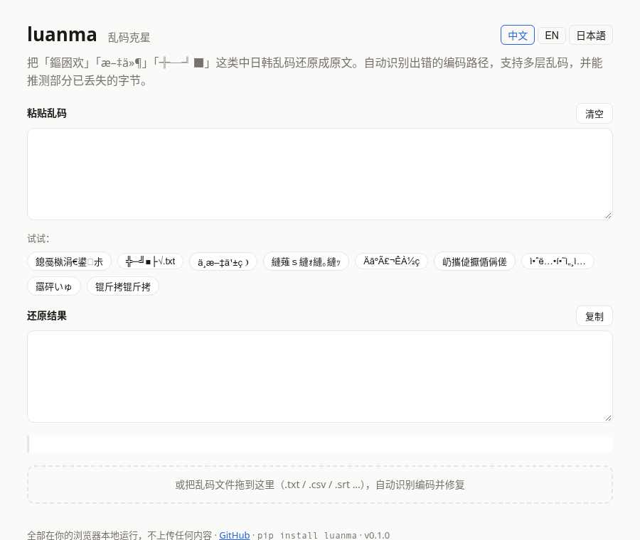

<div align="center">


# luanma · 乱码克星

**`浣犲ソ涓栫晫` → `你好世界`。粘贴乱码，秒回原文，还告诉你它是怎么坏的。**

[](https://github.com/3566264817a-cyber/luanma/actions/workflows/ci.yml)


[](https://3566264817a-cyber.github.io/luanma/)

### [👉 在线试用（不用安装，不上传）](https://3566264817a-cyber.github.io/luanma/)

[English](README.md) · 简体中文 · [日本語](README.ja.md)



</div>

---

## 😫 这些你一定见过

| 你看到的 | luanma 还原 | 发生了什么 |
|---|---|---|
| `浣犲ソ涓栫晫` | **你好世界** | UTF-8 文件被记事本 / Excel 当成 GBK 打开 |
| `╬─╝■├√.txt` | **文件名.txt** | Windows 打包的 zip，在 Mac / Linux 上解压 |
| `ÄãºÃ£¬ÊÀ½ç` | **你好，世界** | GBK 存进了 MySQL 的 `latin1` 字段 |
| `我是一åªçŒ«` | **我是一只猫** | 网页 / 邮件 / 接口把 UTF-8 当成 Latin-1 |
| `羉砰いゅ` | **繁體中文** | 繁体 Big5 在简体系统上打开 |
| `縺薙ｓ縺ｫ縺｡縺ｯ` | **こんにちは** | 日文 UTF-8 被当成 Shift-JIS |
| `屷攜偼擫偱偁傞` | **吾輩は猫である** | 日文游戏 / 软件在中文系统上运行 |
| `救崇窍技夸` | **안녕하세요** | 韩文 EUC-KR 被当成 GBK |
| `娑旇京鐖滈梻顕€顣�` | **乱码问题** | 乱码又被乱码了一次（两层） |
| `锟斤拷` | 告诉你原文已经丢了 | 见下面的 [FAQ](#-锟斤拷和烫烫烫到底是什么) |

你不用知道它是哪种编码、错了几次，luanma 会自己找出来。

## ⚡ 30 秒上手

```bash
pip install git+https://github.com/3566264817a-cyber/luanma   # Python ≥ 3.9，零依赖
```

```bash
$ luanma "浣犲ソ涓栫晫"
你好世界

$ luanma explain "╬─╝■├√.txt"
文件名.txt
  第1次出错：GBK 编码的内容被当成 CP437(DOS) 解码
  可信度约 98%（评分 -0.70 → 2.50）

$ luanma -f 乱码.csv -o 修好.csv     # 整个文件（原始 GBK / Big5 / Shift-JIS / EUC-KR 字节也能自动识别）
$ luanma zip 下载.zip               # 看清 zip 里乱码文件的真名
$ cat 乱码.txt | luanma             # 管道
```

```python
import luanma

luanma.fix_text("我是一åªçŒ«")    # '我是一只猫'

r = luanma.fix("鏂囦欢鍚嶏細")
r.fixed, r.changed                  # ('文件名：', True)
print(r.explain())                  # 哪一步编码错了、补回了几个字节、可信度（也支持 "en" / "ja"）
```

不想装？直接用 **[网页版](https://3566264817a-cyber.github.io/luanma/)**：只有一个 HTML 文件，可以拖入整个文件修复，下载回来就是 UTF-8，断网也能用。

## ✨ 为什么好用

- 🧭 **不用猜编码**：在 UTF-8、GBK、Big5、Shift-JIS、EUC-KR、Windows-1252、Latin-1、CP437 之间自动搜索，最多反推 3 层错误。
- 🩹 **能补回丢失的字节**：乱码里常见的 `�`，luanma 会按上下文和字频推测原字，并如实告诉你猜了几个。
- 🛡️ **不误伤**：正常文本原样不动；一句话里只有一段是乱码，就只修那一段。618 条正常文本测试，误改 **0** 条。
- 🗣️ **会解释**：告诉你「UTF-8 被当成了 GBK」，下次就知道该怎么避免。支持中文 / English / 日本語。
- 📦 **零依赖、免维护**：纯 Python；编码是冻结的国家标准，字频表一次生成就不用再更新。
- 🔒 **隐私**：网页版完全在浏览器本地运行，什么都不上传。

## 🆚 和 ftfy、chardet 有什么不同？

[ftfy](https://github.com/rspeer/python-ftfy) 是最有名的乱码修复库，但它的文档[明确写着](https://ftfy.readthedocs.io/en/latest/avoid.html)不处理 GBK、Big5、Shift-JIS、EUC-KR。chardet / charset-normalizer 只能猜原始字节是什么编码，没法修已经显示坏了的文字。

| | luanma | ftfy | chardet / charset-normalizer |
|---|:-:|:-:|:-:|
| UTF-8 被当成 Latin-1 / Windows-1252（`我是`） | ✅ | ✅ | ❌ |
| UTF-8 被当成 GBK / Big5 / Shift-JIS / EUC-KR（`浣犲ソ`） | ✅ | ❌ | ❌ |
| GBK / Big5 / Shift-JIS 被当成 Latin-1 / CP437（`ÄãºÃ`、`╬─╝■`） | ✅ | ❌ | ❌ |
| 多层乱码 | ✅ 最多 3 层 | ✅（仅西文） | ❌ |
| 推测已丢失的字节（`�`） | ✅ | ❌ | ❌ |
| 识别文件的原始编码 | ✅ | ❌ | ✅ |
| 说明出错原因 | ✅ 中/英/日 | ✅ | – |
| 网页版 | ✅ 离线单文件 | ❌ | ❌ |

## 📊 测试结果

用 **2774** 条维基百科句子（简体、繁体、日文、韩文，都没参与建表）模拟 15 种真实乱码，再交给 luanma 修复：

- **没有丢字节的场景基本全部还原**：Windows-1252、Latin-1、MySQL latin1、zip 文件名、Big5→GBK、日文游戏等都是 **100%**。
- 总体 **82%** 完全还原，字符准确率 **92.7%**；误伤 **0 / 618**。
- 网页版和 Python 版的输出 **99.4%** 一致。

<details>
<summary>展开完整结果表</summary>

| 场景 | 样本 | 含丢失字节 | 完全还原 | 字符准确率 |
|---|--:|--:|--:|--:|
| UTF-8 被当 GBK 读（Windows 记事本/Excel） | 210 | 206 | 85% | 99.1% |
| UTF-8 被当 Windows-1252 读（网页/邮件） | 468 | 0 | 100% | 100.0% |
| UTF-8 被当 Latin-1 读（数据库/接口） | 200 | 0 | 100% | 100.0% |
| GBK 被当 Latin-1 读（MySQL latin1 字段） | 200 | 0 | 100% | 100.0% |
| GBK 被当 CP437 读（Windows zip 文件名） | 210 | 0 | 100% | 100.0% |
| GBK 被当 Big5 读（简体在繁体系统） | 200 | 89 | 60% | 93.1% |
| Big5 被当 GBK 读（繁体在简体系统） | 85 | 0 | 100% | 100.0% |
| UTF-8 被当 Big5 读 | 120 | 120 | 0% | 11.5% |
| Shift-JIS 被当 GBK 读（日文游戏/软件） | 146 | 0 | 100% | 100.0% |
| UTF-8 被当 Shift-JIS 读 | 146 | 146 | 39% | 95.7% |
| Shift-JIS 被当 CP437 读（日文 zip） | 146 | 0 | 98% | 98.2% |
| EUC-KR 被当 GBK 读（韩文软件） | 121 | 0 | 96% | 98.0% |
| UTF-8 被当 EUC-KR 读 | 122 | 122 | 0% | 53.5% |
| 两层：UTF-8→GBK 乱码两次 | 200 | 116 | 78% | 93.7% |
| 两层：UTF-8→Windows-1252 乱码两次 | 200 | 0 | 100% | 100.0% |
| **合计** | **2774** | **799** | **82%** | **92.7%** |

如果错误的解码已经把字节毁掉了（UTF-8 被当成 Big5 / EUC-KR / Shift-JIS，GBK 被当成 Big5），信息本身就丢了一部分，luanma 会尽量推测，推不出来的用 `�` 标出。这几行是如实的上限，不是 bug。其中「UTF-8 被当 Big5 读」丢失太多，luanma 会选择原样保留，而不是瞎猜。复现：`python bench/run.py`。

</details>

## 🤔 「锟斤拷」和「烫烫烫」到底是什么？

- **锟斤拷**：GBK 文字被当成 UTF-8 读取，读不懂的字节全被换成替换符 `U+FFFD`；保存后它变成字节 `EF BF BD`，再用 GBK 显示，每两个替换符就是「锟斤拷」。**原文在第一步就被丢弃了**，任何工具都救不回来，luanma 会直接告诉你这一点，不瞎修。
- **烫烫烫 / 屯屯屯**：不是乱码。VC++ 调试模式会用 `0xCC`（栈）和 `0xCD`（堆）填充未初始化的内存，按 GBK 显示刚好是「烫」和「屯」。这说明程序读了没初始化的内存。
- **为什么 Excel 打开 CSV 是乱码？** 中文 Windows 上的 Excel 会把不带 BOM 的 UTF-8 CSV 当成 GBK 打开。用 `luanma -f` 修好，或者导出时选「UTF-8 带 BOM」。
- **Mac 上解压 zip 文件名全是 `╬─╝■`？** Windows 用 GBK 存文件名，解压软件却按 CP437 读。`luanma zip 文件.zip` 可以看到每个文件的真名。

## 🔧 原理

1. **搜索**：乱码就是一串「A 编码的字节被当成 B 解码」的错误。luanma 在 8 种编码之间做束搜索，逐层反推。
2. **打分**：用字频（jieba 词典）、3.1 万个常用双字词、各国标准常用字表来判断「像不像人话」，并惩罚典型乱码特征（`�`、私用区字符、半角片假名、制表符号、组不成词的汉字……）。
3. **补字节**：遇到已经丢失的字节，按上下文和字频推测，并告诉你猜了几个。
4. **不伤正文**：只有看起来像乱码的文本才会被处理，修复结果必须明显更好才会采用。

## ⚠️ 局限

- 只有 1～2 个字的短文本很难判断，luanma 倾向于不改。
- 只支持上面列出的编码。西里尔文、泰文等的乱码不在范围内；西文的 UTF-8 ↔ Windows-1252 乱码可以用 ftfy。
- 字频数据来自中文；日文、韩文主要依靠 JIS / KS 标准字表，效果不错但更粗一些。

<details>
<summary>🛠️ 开发</summary>

```bash
python tests/test_basic.py          # 单元测试
python bench/run.py [-v]            # 跑基准（-v 打印每个失败样本）
python tools/build_web.py 用户名/luanma   # 修改 web/ 或 luanma/freq.py 后重新生成 docs/index.html
node web/test.mjs                   # 测试网页版
python bench/run.py --dump /tmp/c.json && node web/bench_browser.cjs /tmp/c.json   # 网页版和 Python 版对比（Chromium）
```

网页版就是 `docs/index.html` 一个文件（约 270 KB），URL 里加 `?q=乱码` 可以预填输入。

</details>

## 📄 数据与许可

MIT。`luanma/freq.py` 来自 [jieba](https://github.com/fxsjy/jieba) 的 `dict.txt`（MIT）和 [OpenCC](https://github.com/BYVoid/OpenCC) 的 `STCharacters.txt` / `STPhrases.txt`（Apache-2.0）。测试句子来自维基百科（CC BY-SA 4.0）。

---

<div align="center">

**如果 luanma 帮你救回了一份文件，点个 ⭐ Star，让更多被乱码折磨的人找到它。**

</div>
